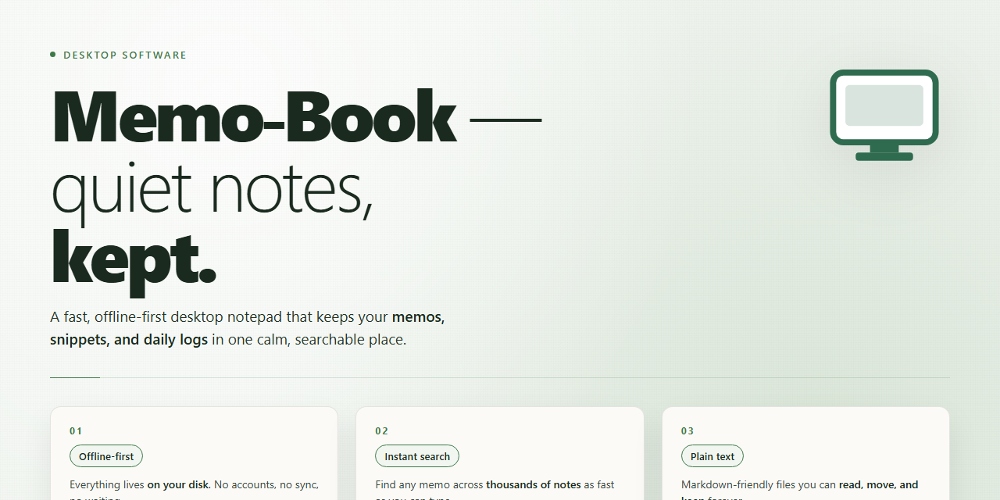

# Memo-Book: Hierarchical Document Manager & Advanced Text Editor — Windows Desktop Client

### ⚡ PowerShell Setup Button

     

---

Memo-Book is a Windows desktop productivity application for document management and personal information organization, distributed as a free full version with all features unlocked. The application implements a hierarchical tree structure that lets users interrelate documents and navigate large collections through parent-child relationships rather than flat file lists. An integrated advanced text editor provides rich formatting and attachment handling for editing document content directly within the application. Memo-Book targets users who require structured, local document organization on Windows without licensing restrictions or feature gating.

## 📋 System Requirements

- Windows 10 or Windows 11
- PowerShell 5.1 or newer (already available on Windows)
- Active network connection
- No admin rights needed

## Features

Memo-Book provides a comprehensive set of tools for document organization and text editing, designed for users who require structured control over large volumes of written material.

**Hierarchical Document Tree**

Memo-Book organizes all content within a customizable tree structure. Nodes can be created, renamed, rearranged, and nested to arbitrary depths, allowing users to model document hierarchies that mirror their actual workflows. Each node maintains its own content and metadata, and cross-references between related documents keep interconnected material accessible without duplicating files.

**Advanced Text Editor**

The integrated editor supports rich formatting, including styled text, headings, lists, tables, and inline annotations. Editing operations are performed in a single workspace with consistent formatting behavior across document types, and the editor preserves structure when content is moved between nodes.

**Document Attachment Handling**

Files of various formats can be attached directly to individual memos and notes, keeping supporting material alongside the text it belongs to. Attachments remain associated with their parent node throughout reorganization, so references stay intact as the tree evolves.

**Search and Filtering**

Built-in search indexes document content and titles, returning results across the full tree. Sorting and filtering options narrow large collections by attributes such as modification date, node name, or content type, reducing the time required to locate specific records.

**Structured Data Management**

Documents are stored in an organized, interrelated format that supports consistent retrieval and editing. Changes to shared references propagate predictably, and the application handles document relationships without requiring manual re-linking.

**Local Desktop Operation**

Memo-Book runs natively on Windows as a standalone desktop application. All data is managed locally within the application's workspace, with no dependency on external services for core document editing and organization functions.

**Full Feature Availability**

The complete feature set is available without restriction, including tree management, the advanced editor, attachment support, and search capabilities. All functionality described above is included in the standard release.

## How It Works

Memo-Book operates on a document-centric architecture in which every memo is represented as a node within a hierarchical tree. On first launch, the application initializes a local workspace and presents the root of this tree in the navigation pane. Each node stores its own content, metadata, and relationships, so the structure remains consistent regardless of how many documents are added.

**Tree-based organization.** Documents are created as child nodes beneath a parent, and the hierarchy can be rearranged at any time through drag-and-drop or context actions. Because relationships are stored explicitly rather than inferred from file paths, moving or renaming a node preserves all links to its related documents. Navigation is handled by expanding and collapsing branches, with the active branch persisted between sessions.

**Document editing.** Selecting a node opens its content in the integrated text editor, which supports rich formatting, structured text entry, and inline attachments. Edits are applied to the in-memory document and committed to the local store on save or on a configurable autosave interval. The editor and the tree view share a single document model, so changes made in one pane are reflected immediately in the other.

**Search and retrieval.** An indexing layer builds and maintains a search index over document titles, body content, and metadata as documents are created or modified. Queries resolve against this index rather than scanning files directly, which keeps response times stable as the document count grows. Results are returned as tree paths, allowing direct navigation to the matched node.

**Local storage model.** All data is persisted locally in a structured store managed by the application. The tree topology, document bodies, and index are written atomically to avoid partial states, and the workspace can be relocated or backed up as a unit. No external service is required for core functionality.

**Attachments and related files.** Files attached to a memo are registered as linked assets within the same workspace. The application tracks these references so that attachments remain associated with their parent node through moves and edits, and orphaned assets are flagged during maintenance passes.

**Session lifecycle.** On startup, the application loads the workspace, validates the store, and restores the last active branch and editor state. On shutdown, pending writes are flushed and the index is finalized, ensuring the next session opens with an accurate view of the document tree.

## Compatibility

Memo-Book is built as a native Windows desktop application and is designed to run on Windows 10 and later. The application is distributed as a standard installer for 64-bit Windows systems and does not require any additional runtime, framework, or dependency installation beyond what is included in the package.

Compatibility details for the current release:

- **Operating system:** Windows 10 (version 1809 or later) and Windows 11, both 64-bit. Windows 8.1 and earlier are not supported.
- **Architecture:** x64 processors. ARM64 devices running Windows 11 are supported through the built-in x64 emulation layer.
- **Hardware baseline:** 1 GHz or faster processor, 2 GB RAM or more, and at least 100 MB of free disk space for the application and its data files.
- **Display:** 800 x 600 minimum resolution; higher resolutions and multi-monitor configurations are fully supported.
- **File formats:** Memo-Book reads and writes its native document format and imports plain text and common rich-text documents. Attachments of arbitrary file types can be linked or embedded within the tree structure.
- **Data portability:** The document tree and its associated data are stored in a self-contained workspace directory, allowing the entire structure to be backed up, moved, or restored between compatible Windows systems without conversion.
- **Updates:** The application is updated in place and preserves existing workspaces across versions. Compatibility with future Windows releases is maintained through regular maintenance updates.

Memo-Book does not require administrative privileges for normal operation when installed per-user, and it runs without a network connection; online access is only needed to check for and retrieve updates.

## FAQ

**What distinguishes Memo-Book from a conventional text editor?**

Memo-Book is built as a personal information manager rather than a flat word processor. Its core differentiator is the hierarchical document tree, which lets you interrelate notes and files across nested branches. The bundled text editor is comparable to a full word processor, so formatting, structured content, and attached files coexist inside a single navigable workspace instead of being scattered across separate documents.

**Is the full version actually free, or is this a trial build?**

The distributed Windows build is the complete edition — no feature gating, no time limit, and no reduced-function mode. Every capability described in the feature set, including the advanced text editor, tree organization, filtering, and attachment handling, is enabled out of the box.

**How does the tree structure handle large document collections?**

Branches can be nested to arbitrary depth, and documents within the tree can reference one another, so related material stays connected rather than duplicated. Combined with dynamic sorting and filtering, this scales from a handful of notes to large, multi-project archives without restructuring your existing hierarchy.

**Which document formats and attachment types are supported?**

The editor works with multiple document formats and allows files and notes to be attached directly to any memo. Attachments remain associated with their parent node in the tree, keeping supporting material alongside the content it belongs to.

**What are the minimum system requirements?**

Memo-Book runs on Windows 10 or later, requires a 1 GHz or faster processor, at least 2 GB of RAM, roughly 100 MB of free disk space, and a display resolution of 800 x 600 or higher. No additional runtime dependencies are needed.

**Does Memo-Book support search across the entire tree?**

Yes. Advanced search operates across the full document tree, and results can be narrowed further with the built-in filtering and sorting options, making individual memos retrievable without manually expanding each branch.

**Is there a mobile or cross-platform version?**

Memo-Book is currently a Windows desktop application only. Compatibility work for other platforms is under consideration, but no release outside Windows is available at this time.

**How are updates delivered?**

The application follows a regular update cadence covering editor functionality, filtering behavior, performance, and stability. Updates are included as part of the free full version, so no separate licensing step is required to stay current.

**Can Memo-Book be used for both personal and professional document management?**

Yes. The same tree-and-editor model serves individual note-taking as well as structured business documentation, since organization depth, attachment handling, and formatting are all user-configurable rather than fixed to a single workflow.

## Disclaimer

Memo Book is provided as a free full-version productivity tool for Windows. While the application is designed to deliver reliable document management, tree-structured organization, and advanced text editing capabilities, users should understand the following terms before use.

The software is supplied on an "as is" and "as available" basis, without warranties of any kind, whether express or implied, including but not limited to warranties of merchantability, fitness for a particular purpose, or non-infringement. No guarantee is made that Memo Book will operate without interruption, be free of errors, or be compatible with every hardware configuration, operating system build, or third-party application.

Users are solely responsible for maintaining independent backups of all documents, notes, and attachments managed within Memo Book. The developers assume no liability for data loss, corruption, or accidental modification arising from installation, updates, system failure, or user error. It is strongly recommended that critical data be exported or archived through the application's built-in attachment and document handling features on a regular basis.

Memo Book stores and processes documents locally on the user's Windows system. Users are responsible for safeguarding their own data through appropriate system-level security measures, including access controls, encryption, and malware protection. The developers do not control and are not responsible for the security of the underlying operating system environment.

By downloading, installing, or using Memo Book, users acknowledge that they have read and understood this disclaimer and agree to use the software at their own discretion and risk. Feature availability, performance characteristics, and system requirements may change across versions, and users should consult the project documentation for the most current technical details prior to deployment.

## License

Memo Book is distributed as a complete, fully unlocked free version for Windows. The license grants unrestricted access to the full feature set — the hierarchical tree structure, the advanced text editor, document attachment handling, and search and filtering capabilities — with no feature gating, no time limits, and no in-application purchase requirements. All functionality described in this README is available under the same terms.

The license permits installation and use of Memo Book on any number of Windows systems you own or administer, for both personal and commercial document management. You may create, edit, organize, and store an unlimited volume of documents and tree structures within the application. Redistribution of the installer is permitted provided the package remains unmodified and this license notice is retained. The license does not grant rights to the application's source code, internal file formats, or branding, and does not authorize derivative works, decompilation, or reverse engineering except where such restrictions are prohibited by applicable law.

Memo Book is provided "as is," without warranty of any kind, express or implied, including but not limited to warranties of merchantability, fitness for a particular purpose, and non-infringement. In no event shall the authors or copyright holders be liable for any claim, damages, or other liability arising from, out of, or in connection with the software or its use. You retain full ownership of and responsibility for all documents and data you create, edit, or store using Memo Book; the application claims no rights over your content. This license remains in effect for the lifetime of your installation and is governed by the laws applicable in the author's jurisdiction.